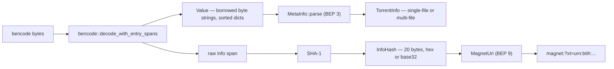

<div align="center">
  
  <p>
    <strong>A magnet-first BitTorrent toolkit for Rust, with no unsafe code and no async runtime</strong><br/>
    <code>magnetite-core</code> decodes bencode into borrowed byte strings, parses magnet URIs and
    <code>.torrent</code> files per BEP 3 and BEP 9, computes infohashes with SHA-1 over the
    raw <code>info</code> bytes, speaks the UDP tracker protocol (BEP 15) with compact peer
    lists (BEP 23/7), frames the peer wire protocol (BEP 10 handshake, BEP 3 messages), and
    carries the runtime-free piece downloader bookkeeping — piece fields, rarest-first
    picking, and bounded block assembly — plus the SHA-1 piece verification that judges
    every assembled piece against the metainfo digests, and the runtime-free per-connection
    session pump that routes wire messages, plans requests under a pipeline cap, and
    requeues rejected pieces — all coordinated across a swarm by the runtime-free endgame
    ledger that duplicates a stalled tail on purpose, and the upload policy that answers
    inbound requests only with verified bytes. Errors are typed, carry byte offsets, stable diagnostic
    codes, and actionable help text. The
    <code>magnetite</code> CLI wraps the library with <code>bencode</code>, <code>magnet</code>, and
    <code>torrent</code> subcommands plus JSON output for scripts and pipelines. Round-trip and
    never-panic properties run under <code>proptest</code>, and CI enforces pedantic clippy with
    <code>-D warnings</code> on Linux, macOS, and Windows.
  </p>
  <p>
    <a href="https://github.com/elcoosp/magnetite/actions/workflows/ci.yml"></a>
    <a href="https://github.com/elcoosp/magnetite/blob/main/Cargo.toml"></a>
    <a href="https://github.com/elcoosp/magnetite/blob/main/LICENSE"></a>
    <a href="https://github.com/elcoosp/magnetite/blob/main/Cargo.toml"></a>
    <a href="https://github.com/elcoosp/magnetite/blob/main/Cargo.toml"></a>
  </p>
</div>

<p align="center">
  <a href="#quickstart">Quickstart</a> • <a href="#features">Features</a> • <a href="#how-it-works">How it works</a> • <a href="#usage">Usage</a> • <a href="#performance">Performance</a> • <a href="#status">Status</a> • <a href="#learn-more">Learn more</a>
</p>

## Quickstart

Prerequisite: Rust 1.85 or newer (edition 2024 workspace, MSRV enforced in CI).

```bash
cargo install --git https://github.com/elcoosp/magnetite magnetite
```

or from a local clone:

```bash
git clone https://github.com/elcoosp/magnetite
cd magnetite
cargo install --path crates/magnetite
```

Decode bencode into JSON and split a magnet URI into typed fields:

```console
$ printf '%s' 'd3:bar4:spam3:fooi42ee' | magnetite bencode decode
{
  "bar": "spam",
  "foo": 42
}

$ magnetite magnet parse "magnet:?xt=urn:btih:c12fe1c06bba254a9dc9f519b335aa7c1367a88a&dn=Ubuntu&tr=udp%3A%2F%2Ft%3A80"
name      : Ubuntu
infohash  : c12fe1c06bba254a9dc9f519b335aa7c1367a88a
tracker   : udp://t:80
```

Both outputs are the exact assertions pinned by the end-to-end tests in
`crates/magnetite/tests/cli.rs`.

> [!TIP]
> `bencode decode` accepts exactly one top-level value; a trailing newline (which `echo` adds)
> fails with a `trailing bytes` error. Use `printf '%s'`, `echo -n`, or pass a file.

## Features

- **Zero-copy bencode codec** — byte strings are borrowed from the input as `Cow` values, so
  parsing a `.torrent` performs no per-byte allocation; nesting is capped at `MAX_DEPTH = 512`
  and allocations are validated against remaining input before they happen
  (`crates/magnetite-core/src/bencode.rs`).
- **Raw-slice infohashing** — the infohash is SHA-1 over the `info` dictionary bytes exactly as
  they appear in the file (span-tracked at decode time), the same digest every mainstream client
  computes, and the tests hash the raw slice independently, so a decoder bug cannot mask a hash
  bug (`crates/magnetite-core/src/metainfo.rs`).
- **Magnet URIs that round-trip** — BEP 9 parsing of hex and base32 `xt` infohashes,
  deduplicated `tr`/`ws`/`x.pe` values, unknown parameters preserved, and a `Display`
  implementation that re-serializes canonically (`crates/magnetite-core/src/magnet.rs`).
- **UDP tracker client, runtime-free** — BEP 15 connect/announce handshake over plain
  `std::net` with read/write timeouts, BEP 23 compact `IPv4` and BEP 7 compact `IPv6`
  peer-list parsing, transaction-id validation, and action-3 tracker errors surfaced in the
  same typed taxonomy; request/reply parsing stays allocation-bounded
  (`crates/magnetite-core/src/tracker.rs`).
- **Peer wire framing and downloader bookkeeping, runtime-free** — BEP 10 handshake and BEP 3
  message framing sliced out of stream chunks with unknown message ids preserved
  (`crates/magnetite-core/src/peer_wire.rs`), and the downloader heart the socket pumps
  into: BEP 3 bit-order piece fields, rarest-first piece selection, and bounded block
  assembly that rejects hostile or duplicate blocks as typed errors
  (`crates/magnetite-core/src/downloader.rs`).
- **Piece verification, runtime-free** — assembled pieces are judged against the metainfo's
  per-piece SHA-1 digests, borrowed straight from the `pieces` field with zero copies: a
  mismatch is an `Ok(false)` verdict that leaves the piece retryable, verified pieces
  accumulate into a `PieceField` the future session acts on, and re-verifying a verified
  piece is a typed error (`crates/magnetite-core/src/verify.rs`).
- **Per-connection session pump, runtime-free** — the message router the downloader
  deferred to: `Bitfield`/`Have` feed swarm bookkeeping, `Choke` evicts the pipeline,
  `Piece` payloads flow through the assembler and the verifier, and outbound block
  requests are planned under a 250-request pipeline cap with cancel bookkeeping;
  a second `Bitfield` is a typed error, and pieces that fail verification are
  requeued through `retry_rejected`, so one corrupt delivery costs a retry instead
  of the download (`crates/magnetite-core/src/session.rs`).
- **Swarm-level endgame and upload policy, runtime-free** — one shared `EndgameBoard`
  per torrent tracks which blocks are missing and how many connections chase each:
  fresh requests are handed out with no cross-connection duplicates, the endgame is
  detected the moment every missing block is chased, and the scarcest in-flight
  demand is duplicated first (capped at 3 chasers per block); the pump's `plan_upload`
  judges inbound requests against the layout and serves only verified bytes,
  refusing the rest as data (`crates/magnetite-core/src/endgame.rs`,
  `crates/magnetite-core/src/session.rs`).
- **Typed errors, not strings** — one error taxonomy for the whole library; bencode failures
  carry the byte offset and one of six fine-grained kinds, and every variant is a
  `miette::Diagnostic` with a stable code and actionable help text
  (`crates/magnetite-core/src/error.rs`).
- **Hostile input is data, not a crash** — `unsafe` is forbidden workspace-wide and proptest
  properties assert that arbitrary and truncated input never panics
  (`crates/magnetite-core/tests/properties.rs`).
- **A CLI built for scripts** — clap v4 with `--json` on every command, stdin support, and
  end-to-end `assert_cmd` tests pinning both human and JSON output
  (`crates/magnetite/src/main.rs`, `crates/magnetite/tests/cli.rs`).

## How it works

One pass through the codec feeds everything else. `MetaInfo::parse` decodes the root dictionary
while the decoder records the byte span of the raw `info` dictionary, and hashes that slice with
SHA-1 to produce the infohash — byte-identical to what libtorrent, qBittorrent, Transmission, or
rqbit compute, canonical input or not.
`MagnetUri` parsing validates the `xt` infohash in either spelling, and `Display`
re-serializes with percent-encoded values that round-trip through `parse`.



## Usage

Every subcommand reads a file argument or stdin (`-` or omitted), and accepts a global
`--json` flag for machine-readable output.

| Command | Purpose |
| --- | --- |
| `magnetite bencode decode [file]` | Decode bencode into JSON; non-UTF-8 byte strings become `{"$hex": "…"}` |
| `magnetite bencode encode [file]` | Encode JSON into canonical bencode; `{"$hex": "…"}` becomes raw bytes |
| `magnetite magnet parse <uri>` | Split a magnet URI into typed fields |
| `magnetite torrent info <file>` | Print name, infohash, size, pieces, files, and trackers |

The `{"$hex": "…"}` convention makes the bencode round-trip lossless: decode emits it for
non-UTF-8 byte strings, encode turns it back into raw bytes.

### As a library

Add the dependency (the crate is not on crates.io yet, so pull it from git):

```toml
[dependencies]
magnetite-core = { git = "https://github.com/elcoosp/magnetite" }
```

```rust
use magnetite_core::bencode;
use magnetite_core::magnet;
use magnetite_core::metainfo::MetaInfo;
use magnetite_core::tracker::{AnnounceParams, UdpTrackerClient};

fn main() -> Result<(), magnetite_core::Error> {
    // Decode bencode without copying byte strings out of the input buffer.
    let value = bencode::decode(b"d3:fooi42ee")?;
    assert_eq!(value.get(b"foo").and_then(|v| v.as_int()), Some(42));

    // Parse a magnet URI (hex or base32 infohash) and re-serialize it canonically.
    let uri = magnet::parse("magnet:?xt=urn:btih:c12fe1c06bba254a9dc9f519b335aa7c1367a88a")?;
    println!("{uri}");

    // Read a .torrent file and get its infohash and derived totals.
    let raw = std::fs::read("ubuntu.torrent")?;
    let meta = MetaInfo::parse(&raw)?;
    println!("{} bytes, infohash {}", meta.total_length(), meta.info_hash);

    // Announce to a UDP tracker (BEP 15): connect once, announce repeatedly.
    let client = UdpTrackerClient::connect(
        "udp://tracker.example:1337/announce",
        std::time::Duration::from_secs(5),
    )?;
    let params = AnnounceParams::new(meta.info_hash, *b"-qB4550-magnetite-x!", 6_881);
    let reply = client.announce(&params)?;
    println!("{} peers, re-announce in {} s", reply.peers.len(), reply.interval);
    Ok(())
}
```

All fallible APIs return `magnetite_core::Result` with the typed `Error` described above;
public items are documented (`missing_docs = warn`), so `cargo doc --open` covers the rest.
Runnable consumer demos live in `crates/magnetite-core/examples/`:
`download_pump` (torrent construction, magnet round-trip, and the session pump fed by a
fake peer), `reject_and_requeue` (a corrupted delivery retried through the requeue loop),
and `endgame_swarm` (two pumps racing one shared endgame board, then the leech turns
seeder): `cargo run -p magnetite-core --example <name>`.

## Performance

Criterion baselines re-measured after the M1 groundwork milestone (raw-slice infohashing) on the
development machine — the metainfo row is ~30% faster than the M0 numbers recorded in
[ARCHITECTURE.md](ARCHITECTURE.md), section 7, because the canonical re-encode is gone. Re-measure
locally with `cargo bench -p magnetite-core`.

| Benchmark | Input | Throughput | Latency |
| --- | --- | --- | --- |
| bencode decode | ~2.9 KiB torrent-shaped dict | 1.58 GiB/s | 1.74 µs |
| bencode decode (span-tracked) | same dict | 0.94 GiB/s | 2.92 µs |
| bencode encode | same dict | 1.52 GiB/s | 1.81 µs |
| metainfo parse | ~8.1 KiB, 64-file torrent | 333 MiB/s | 23.1 µs |
| magnet URI parse | typical URI | 11.3 GiB/s | 0.66 µs |
| tracker connect-request build | 16 B | 26.2 GiB/s | 0.57 ns |
| tracker announce-request build | 98 B | 30.6 GiB/s | 2.98 ns |
| tracker connect-response parse | 16 B | 3.2 GiB/s | 4.67 ns |
| tracker announce-response parse | 320 B, 50 peers | 7.5 GiB/s | 39.7 ns |
| tracker announce-response parse | 3,032 B, 502 peers | 12.4 GiB/s | 228.5 ns |
| compact peer list parse | 6,144 B, 1,024 peers | 14.7 GiB/s | 388.6 ns |
| bitfield parse | 2,048 B, 16,384 pieces | 543 MiB/s | 3.60 µs |
| availability add-peer | 2,048 B bitfield | 65.6 MiB/s | 29.8 µs |
| rarest-first pick | 16,384 pieces | 84.9 MiB/s | 23.0 µs |
| block assembly, one piece | 4 MiB, 256 blocks | 5.85 GiB/s | 667.8 µs |
| block assembly, full download | 32 MiB, 1,024 pieces | 15.2 GiB/s | 2.05 ms |
| piece verify, pass | 4 MiB piece | 1.73 GiB/s | 2.25 ms |
| piece verify, mismatch detected | 4 MiB piece | 1.73 GiB/s | 2.26 ms |
| piece verify, full download | 32 MiB, 1,024 pieces | 1.68 GiB/s | 18.6 ms |
| session route, full download | 32 MiB, 1,024 pieces | 1.17 GiB/s | 26.7 ms |
| session request planning (rarest-first) | 1,024-piece have-list | — | 3.58 µs |
| session requeue + re-plan | burned 32 KiB piece, 1,024-piece layout | — | 4.30 µs |
| session endgame duplicate request | fully chased 32 MiB tail, 1,024 pieces | — | 292.3 µs |
| session upload serve policy | verified 16 KiB block | — | 5.3 ns |
| endgame scarcest pick | fully chased 32 MiB tail, 1,024 pieces | — | 144.4 µs |
| endgame record + release | one block | — | 24.4 ns |
| pipeline record + release | 125-block round-trip | — | 59 ns/request |

The tracker rows were measured on the sandbox runner for the tracker milestone drop
(`cargo bench --bench tracker`); packet parsing is a handful of big-endian slice reads, so
latency stays in the nanosecond range even for 502-peer replies. The downloader rows were
measured on the same sandbox runner for the downloader-groundwork drop
(`cargo bench --bench download`); assembly is bounded copy fan-in at memory bandwidth,
while the bitfield/picker rows show that 16k-piece swarm bookkeeping costs tens of
microseconds per event. The verify rows were measured on the same sandbox runner for the
piece-verification drop (`cargo bench --bench verify`); verdicts run at SHA-1 throughput,
and the mismatch path costs the same as the pass path because the digest is computed
either way — detection is free beyond the hash. The session rows were measured on the
same sandbox runner for the session-groundwork drop (`cargo bench --bench session`);
route cost is the sum of its stages — per-block planning (`next_request` at ~3.6 µs
over a 1,024-piece have-list), block assembly, and the verifier — so 1.17 GiB/s is
SHA-1 throughput plus bounded bookkeeping, and pipeline record/release stays at
tens of nanoseconds per request. The requeue row was measured on the same
sandbox runner for the re-request-loop drop (`cargo bench --bench session`);
reopening a burned piece and re-planning its first request costs a few
microseconds of bookkeeping on top of the routing path. The endgame and
upload rows were measured on the same sandbox runner for the endgame-upload
drop (`cargo bench --bench session`): a duplicate request pays the
fresh-walk candidate scan over a 1,024-piece have-list plus the board's
scarcest pick (the pick alone scans 2,048 missing blocks in ~144 µs), the
ledger's record/release round-trip stays at tens of nanoseconds, and the
upload policy's layout checks plus verified-field probe cost single-digit
nanoseconds — refusing an unverified request costs exactly as little.

## Status

> [!NOTE]
> Magnetite is at the beginning of its life: milestone M0 (the parsing layer), the M1
> groundwork milestone (raw-slice infohashing via entry-span tracking), the M1 tracker
> milestone (BEP 15 UDP tracker client, BEP 23/7 compact peer lists), the M1 peer wire
> milestone (BEP 10 handshake, BEP 3 message framing), the M1 downloader groundwork
> milestone (piece fields, rarest-first picking, bounded block assembly), the M1
> piece verification milestone (SHA-1 verdicts, verified piece field), the M1 session
> groundwork drop (per-connection request pipeline and message router, shipped in
> 0.5.1), the M1 re-request loop (rejected pieces are requeued through
> `retry_rejected` and retried clean, shipped in 0.6.0), and the M1 endgame-upload
> groundwork (a swarm-level duplicate-request ledger, endgame detection and picking,
> and the upload serve policy, shipped in 0.6.0) are done. Expect API changes
> before 1.0.
> Nothing downloads over a socket yet — the tokio stream session, DHT, and storage
> planned in [ARCHITECTURE.md](ARCHITECTURE.md) are the following milestones; the
> stream session is now purely the I/O edge, since every bookkeeping decision it
> needs is runtime-free.
> The crates are not published on crates.io yet, so install from git or a clone. CI tests
> Linux, macOS, and Windows; release artifacts target x86_64 Linux,
> arm64 and x86_64 macOS, and x86_64 Windows (MSVC). MSRV is 1.85 (edition 2024), checked in
> a dedicated CI job.

## Learn more

- [ARCHITECTURE.md](ARCHITECTURE.md) — competitive analysis, component contracts, error
  model, testing strategy, and the M1–M4 roadmap.
- [CHANGELOG.md](CHANGELOG.md) — generated from Conventional Commits by git-cliff.
- Proposals implemented so far: [BEP 3](https://www.bittorrent.org/beps/bep_0003.html)
  (bencode, metainfo), [BEP 9](https://www.bittorrent.org/beps/bep_0009.html) (magnet URIs),
  [BEP 15](https://www.bittorrent.org/beps/bep_0015.html) (UDP tracker protocol), and
  [BEP 23](https://www.bittorrent.org/beps/bep_0023.html)/[BEP 7](https://www.bittorrent.org/beps/bep_0007.html)
  (compact peer lists).
