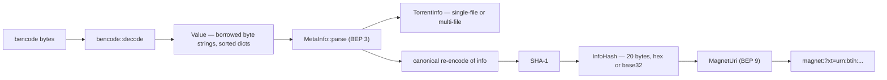

<div align="center">
  
  <p>
    <strong>Zero-copy BitTorrent metainfo parsing for Rust, with no unsafe code and no async runtime</strong><br/>
    <code>magnetite-core</code> decodes bencode into borrowed byte strings, parses magnet URIs and
    <code>.torrent</code> files per BEP 3 and BEP 9, and computes infohashes with SHA-1 over the
    canonical encoding — errors are typed and carry byte offsets. The <code>magnetite</code> CLI wraps
    the library with <code>bencode</code>, <code>magnet</code>, and <code>torrent</code> subcommands plus
    JSON output for scripts and pipelines. Round-trip and never-panic properties run under
    <code>proptest</code>, and CI enforces pedantic clippy with <code>-D warnings</code> on Linux, macOS,
    and Windows.
  </p>
  <p>
    <a href="https://github.com/elcoosp/magnetite/actions/workflows/ci.yml"></a>
    <a href="https://github.com/elcoosp/magnetite/blob/main/Cargo.toml"></a>
    <a href="https://github.com/elcoosp/magnetite/blob/main/LICENSE"></a>
    <a href="https://github.com/elcoosp/magnetite/blob/main/Cargo.toml"></a>
    <a href="https://github.com/elcoosp/magnetite/blob/main/Cargo.toml"></a>
  </p>
</div>

<p align="center">
  <a href="#quickstart">Quickstart</a> • <a href="#features">Features</a> • <a href="#how-it-works">How it works</a> • <a href="#usage">Usage</a> • <a href="#performance">Performance</a> • <a href="#status">Status</a> • <a href="#learn-more">Learn more</a>
</p>

## Quickstart

Prerequisite: Rust 1.85 or newer (edition 2024 workspace, MSRV enforced in CI).

```bash
cargo install --git https://github.com/elcoosp/magnetite magnetite
```

or from a local clone:

```bash
git clone https://github.com/elcoosp/magnetite
cd magnetite
cargo install --path crates/magnetite
```

Decode bencode into JSON and split a magnet URI into typed fields:

```console
$ printf '%s' 'd3:bar4:spam3:fooi42ee' | magnetite bencode decode
{
  "bar": "spam",
  "foo": 42
}

$ magnetite magnet parse "magnet:?xt=urn:btih:c12fe1c06bba254a9dc9f519b335aa7c1367a88a&dn=Ubuntu&tr=udp%3A%2F%2Ft%3A80"
name      : Ubuntu
infohash  : c12fe1c06bba254a9dc9f519b335aa7c1367a88a
tracker   : udp://t:80
```

Both outputs are the exact assertions pinned by the end-to-end tests in
`crates/magnetite/tests/cli.rs`.

> [!TIP]
> `bencode decode` accepts exactly one top-level value; a trailing newline (which `echo` adds)
> fails with a `trailing bytes` error. Use `printf '%s'`, `echo -n`, or pass a file.

## Features

- **Zero-copy bencode codec** — byte strings are borrowed from the input as `Cow` values, so
  parsing a `.torrent` performs no per-byte allocation; nesting is capped at `MAX_DEPTH = 512`
  and allocations are validated against remaining input before they happen
  (`crates/magnetite-core/src/bencode.rs`).
- **Spec-exact infohashing** — the infohash is SHA-1 over the canonical (byte-sorted) re-encoding
  of the `info` dictionary, and the tests hash the raw slice independently, so an encoder bug
  cannot mask a hash bug (`crates/magnetite-core/src/metainfo.rs`).
- **Magnet URIs that round-trip** — BEP 9 parsing of hex and base32 `xt` infohashes,
  deduplicated `tr`/`ws`/`x.pe` values, unknown parameters preserved, and a `Display`
  implementation that re-serializes canonically (`crates/magnetite-core/src/magnet.rs`).
- **Typed errors, not strings** — one error taxonomy for the whole library; bencode failures
  carry the byte offset and one of six fine-grained kinds
  (`crates/magnetite-core/src/error.rs`).
- **Hostile input is data, not a crash** — `unsafe` is forbidden workspace-wide and proptest
  properties assert that arbitrary and truncated input never panics
  (`crates/magnetite-core/tests/properties.rs`).
- **A CLI built for scripts** — clap v4 with `--json` on every command, stdin support, and
  end-to-end `assert_cmd` tests pinning both human and JSON output
  (`crates/magnetite/src/main.rs`, `crates/magnetite/tests/cli.rs`).

## How it works

One pass through the codec feeds everything else. `MetaInfo::parse` decodes the root dictionary,
re-encodes the `info` dictionary canonically (dictionaries parse into `BTreeMap`, so keys are
sorted byte-wise), and hashes that encoding with SHA-1 to produce the infohash — for
spec-compliant torrents the result is byte-identical to hashing the raw `info` slice.
`MagnetUri` parsing validates the `xt` infohash in either spelling, and `Display`
re-serializes with percent-encoded values that round-trip through `parse`.



## Usage

Every subcommand reads a file argument or stdin (`-` or omitted), and accepts a global
`--json` flag for machine-readable output.

| Command | Purpose |
| --- | --- |
| `magnetite bencode decode [file]` | Decode bencode into JSON; non-UTF-8 byte strings become `{"$hex": "…"}` |
| `magnetite bencode encode [file]` | Encode JSON into canonical bencode; `{"$hex": "…"}` becomes raw bytes |
| `magnetite magnet parse <uri>` | Split a magnet URI into typed fields |
| `magnetite torrent info <file>` | Print name, infohash, size, pieces, files, and trackers |

The `{"$hex": "…"}` convention makes the bencode round-trip lossless: decode emits it for
non-UTF-8 byte strings, encode turns it back into raw bytes.

### As a library

Add the dependency (the crate is not on crates.io yet, so pull it from git):

```toml
[dependencies]
magnetite-core = { git = "https://github.com/elcoosp/magnetite" }
```

```rust
use magnetite_core::bencode;
use magnetite_core::magnet;
use magnetite_core::metainfo::MetaInfo;

fn main() -> Result<(), magnetite_core::Error> {
    // Decode bencode without copying byte strings out of the input buffer.
    let value = bencode::decode(b"d3:fooi42ee")?;
    assert_eq!(value.get(b"foo").and_then(|v| v.as_int()), Some(42));

    // Parse a magnet URI (hex or base32 infohash) and re-serialize it canonically.
    let uri = magnet::parse("magnet:?xt=urn:btih:c12fe1c06bba254a9dc9f519b335aa7c1367a88a")?;
    println!("{uri}");

    // Read a .torrent file and get its infohash and derived totals.
    let meta = MetaInfo::parse(&raw)?;
    println!("{} bytes, infohash {}", meta.total_length(), meta.info_hash);
    Ok(())
}
```

All fallible APIs return `magnetite_core::Result` with the typed `Error` described above;
public items are documented (`missing_docs = warn`), so `cargo doc --open` covers the rest.

## Performance

Criterion baselines recorded for milestone M0 on the author's machine — see
[ARCHITECTURE.md](ARCHITECTURE.md), section 7. Re-measure locally with
`cargo bench -p magnetite-core`.

| Benchmark | Input | Throughput | Latency |
| --- | --- | --- | --- |
| bencode decode | ~2.7 KiB torrent-shaped dict | 1.51 GiB/s | 1.82 µs |
| bencode encode | same dict | 1.41 GiB/s | 1.95 µs |
| metainfo parse | ~7.6 KiB, 64-file torrent | 236 MiB/s | 32.6 µs |
| magnet URI parse | typical URI | 11.3 GiB/s | 0.67 µs |

The metainfo path is the slowest by design: it re-encodes the `info` dictionary for a
spec-exact infohash instead of hashing the raw slice. ARCHITECTURE.md lists span-tracking
as the planned optimization.

## Status

> [!NOTE]
> Magnetite is at the beginning of its life: 27 commits, one milestone (M0, the parsing
> layer), version 0.1.0. Expect API changes before 1.0. Nothing downloads yet — the tracker
> client, peer wire protocol, DHT, and storage planned in [ARCHITECTURE.md](ARCHITECTURE.md)
> are future milestones M1–M4. The crates are not published on crates.io and no release has
> been tagged, so install from git or a clone. CI tests Linux, macOS, and Windows; release
> artifacts target x86_64 Linux, arm64 and x86_64 macOS, and x86_64 Windows (MSVC). MSRV is
> 1.85 (edition 2024), checked in a dedicated CI job.

## Learn more

- [ARCHITECTURE.md](ARCHITECTURE.md) — competitive analysis, component contracts, error
  model, testing strategy, and the M1–M4 roadmap.
- [CHANGELOG.md](CHANGELOG.md) — generated from Conventional Commits by git-cliff.
- Proposals implemented so far: [BEP 3](https://www.bittorrent.org/beps/bep_0003.html)
  (bencode, metainfo) and [BEP 9](https://www.bittorrent.org/beps/bep_0009.html) (magnet URIs).
